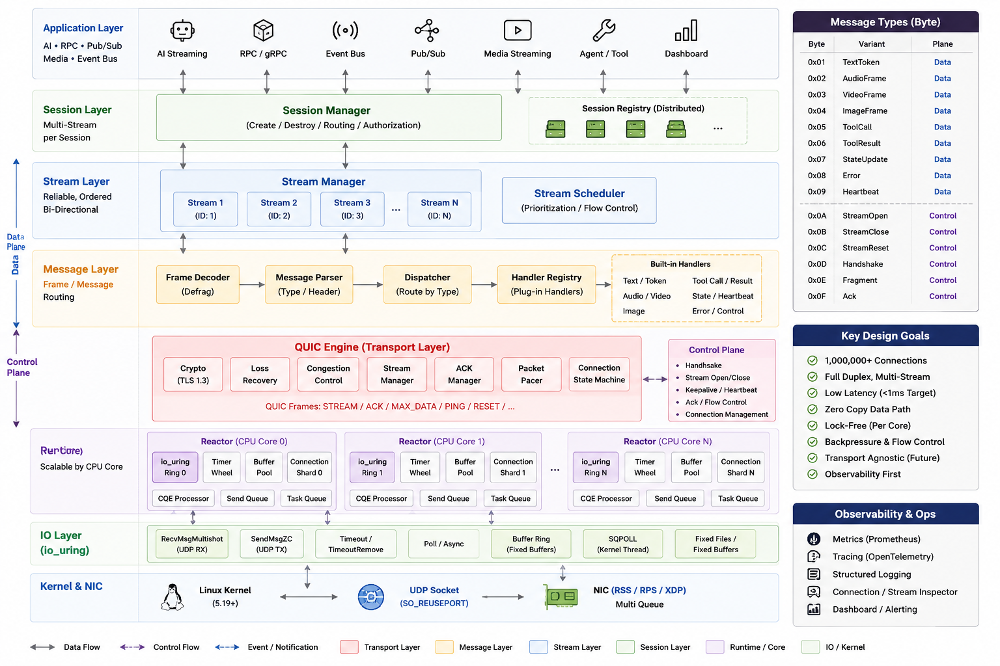

<div align="center">
  <h1>Vireon</h1>

  <p>
    <strong>A QUIC-native pub/sub runtime with per-stream delivery semantics,
    WAL persistence, consumer groups, and adaptive fan-out.</strong>
  </p>

  <p>
    <a href="https://github.com/vireon-duplex/vireon/actions"></a>
    <a href="https://github.com/vireon-duplex/vireon/releases"></a>
    <a href="./LICENSE"></a>
    <a href="https://rust-lang.org"></a>
  </p>
</div>

---

## About

Vireon is a pub/sub runtime built in Rust on **QUIC** (`quiche`) and
**`io_uring`**. Each subscriber opens a dedicated QUIC stream with its own
flow-control and loss-recovery window, so a congested topic (heavy video,
bursty telemetry) never blocks lighter topics — the core differentiator over
single-stream transports.

The server is a single binary (`quic-server`) that handles the data plane;
clients connect through the Rust SDK (`vireon-sdk`). Both ship in this repo.

### Highlights

- **Per-stream delivery policies** — `ReliableOrdered`, `LatestOnly`,
  `RealtimeDropOld`. Declared at stream-open; enforced by the server's
  send-policy layer.
- **WAL persistence** — durable publish with offset-based replay
  (`Fetch`/`FetchReply` protocol). Survives subscriber disconnects and
  enables crash recovery.
- **Adaptive fan-out** — `BatchPush` (encode once, `Bytes::clone` per sub)
  for small fan-out; `LogTail` (WAL append + lightweight `NotifyOffset`) for
  large fan-out. Auto-selected from a configurable threshold.
- **Consumer groups** — load-balanced round-robin delivery across N members,
  one message per consumer per publish.
- **Cluster mode** — consistent-hash-ring routing with configurable
  replication factor; cross-node fan-out via the inter-node UDP mesh.
- **Connection migration** — clients survive NAT/Wi-Fi handoff without
  reconnect (QUIC path migration, separate from multipath).
- **mTLS** — optional client certificate verification at the TLS layer.
- **io_uring data plane** — zero-copy sends, registered buffers, SQPOLL,
  multishot receive. Bypasses syscall-per-packet overhead.

## Quick start

```bash
git clone https://github.com/vireon-duplex/vireon.git
cd vireon
cargo build --release

# Self-signed dev cert (production: use a real CA).
openssl req -x509 -newkey rsa:2048 -keyout key.pem -out cert.pem \
  -days 365 -nodes -subj "/CN=localhost"

# Start the server.
./target/release/quic-server --cert cert.pem --key key.pem --port 4433
```

Server is now listening on `127.0.0.1:4433`. Open another terminal and run an
example:

```bash
# All 3 delivery policies in one run.
cargo run -p vireon-sdk --release --example quickstart
```

For the full tutorial — publisher/subscriber code, connection pool, consumer
groups, WAL, cluster, production checklist — see
[`docs/getting-started.md`](./docs/getting-started.md).

## Configuration

Beyond quick testing, use a TOML config file:

```toml
# vireon.conf
bind = "0.0.0.0"
port = 4433
cert = "/etc/vireon/cert.pem"
key  = "/etc/vireon/key.pem"
mode = "multi"          # "single" | "multi"
workers = 0             # 0 = auto (one per CPU core)
metrics_port = 9090     # Prometheus /metrics endpoint

[delivery]
logtail_threshold = 256  # switch to LogTail above this fan-out

# WAL (enables durable delivery + crash recovery)
wal_root = "/var/lib/vireon/wal"
[wal_sync]
mode = "batched"          # "never" | "batched" | "fsync"
```

```bash
./target/release/quic-server --config vireon.conf
```

CLI flags override the config file. Key flags:

| Flag | Purpose |
|---|---|
| `--cert` / `--key` | TLS certificate + private key |
| `--client-ca` | Enable mTLS (require client certs) |
| `--mode single\|multi` | Worker thread model |
| `--workers N` | Worker count (0 = auto) |
| `--wal-root PATH` | Enable WAL at this directory |
| `--metrics-port N` | Prometheus scrape port |
| `--cluster-node-id N` | Cluster node identity (enables cluster mode) |
| `--cluster-peers MAP` | `id=host:port,id=host:port,...` |
| `--cluster-replication-factor N` | Topic replication (default 1) |
| `--skip-crc` / `--enforce-crc` | Toggle CRC32C verification (default skip) |
| `--config FILE` | Load TOML config |

Run `quic-server --help` for the full list.

## Architecture

Layered Clean Architecture. Dependencies point inward only — the domain
knows nothing about I/O.

<div align="center">
  
</div>

Layer breakdown:

| Layer | Crates | Responsibility |
|---|---|---|
| **message** | `frame` | Wire format: header, payload codecs, CRC32C |
| **io** | `io` | `io_uring` ring, registered buffers, zero-copy send |
| **runtime** | `buffer-pool`, `timer-wheel`, `task-queue`, `cqe-processor`, `reactor`, `send-queue`, `connection-shard` | Async runtime primitives |
| **transport** | `quic-engine` | QUIC packet routing, stream scheduler, pacer |
| **session** | `session-manager`, `session-registry`, `session-router`, `session-migration-manager`, `session-replication-service` | Connection state, cluster membership |
| **stream** | `stream-manager`, `stream-scheduler`, `delivery-policy`, `send-policy` | Per-stream semantics, fairness, drop policy |
| **application** | `pubsub-engine`, `wal-store`, `consumer-groups`, `cluster-coordinator`, `topic-acl`, `auth-framework`, `resource-quotas`, `observability-sdk` | Pub/sub domain: topics, patterns, fan-out, ACL |
| **binary** | `quic-server`, `quic-client`, `bench-harness`, `vireon-sdk`, `profiler` | Binaries and the client SDK |

See [`ARCHITECTURE.md`](./ARCHITECTURE.md) for the authoritative design
reference, and [`OPERATIONS.md`](./OPERATIONS.md) /
[`DEPLOYMENT.md`](./DEPLOYMENT.md) for production operations.

## Examples

The SDK ships runnable scenarios under
[`client-sdk/examples/`](./client-sdk/examples/). Each one auto-spawns its
own server on an ephemeral port.

| Scenario | Proves |
|---|---|
| `quickstart` | All 3 delivery policies in one run |
| `s07_hol_congestion` | 5 dedicated streams — video congestion does not degrade lighter streams |
| `s09_reconnect` | Server killed mid-session; SDK reconnects + replays subscriptions |
| `s10_mtls` | Mutual TLS with client certificate verification |
| `s11_ordering` | 500 frames on `ReliableOrdered` — exact-once, in-order, zero gaps |
| `s12_full_limit` | Max fan-out throughput under sustained publish |
| `s13_aggregate_throughput` | Multi-connection aggregate bandwidth |
| `s14_pool_multiplex` | `ClientPool` publish-side multiplexing across N connections |
| `s15_consumer_group` | Load-balanced consumer group delivery |
| `s16_cluster_replication` | 3-node cluster, replication-factor 2 |
| `s17_multicore_modes` | SDK correctness under single-worker and multi-worker servers |
| `s18_cross_node_fanout` | Cross-node delivery through the consistent hash ring |
| `s19_connection_migration` | QUIC connection migration survives a UDP rebind |
| `s20_logtail_delivery` | LogTail path (WAL + `NotifyOffset` + auto-Fetch) |

```bash
cargo run -p vireon-sdk --release --example <name>
```

## Quality

```bash
# Format + lint.
cargo fmt --all -- --check
cargo clippy --all-targets --all-features -- -D warnings

# Test suite.
cargo test --workspace

# Security and dependency audit.
cargo audit
cargo deny check
```

See [`TESTING.md`](./TESTING.md) for the testing strategy and coverage layers.

## Profiling

Vireon ships two complementary profilers:

1. **In-process function profiler** (`profiler/`) — `#[profile]` attribute
   macro that times annotated functions with sub-microsecond overhead.
   Exports as text, JSON, CSV, Chrome Trace, flamegraph, or Graphviz.
   See [`profiler/DESIGN.md`](./profiler/DESIGN.md).

   ```bash
   cargo run --release -p quic-server --features profiling -- \
     --cert cert.pem --key key.pem --port 4433 \
     --profile-output report.json
   ```

2. **`perf`-based flamegraph** — samples the entire call stack (including
   stdlib, `quiche`, syscalls) with zero code changes. The
   `scripts/flamegraph.sh` orchestrator builds, loads, records, and renders:

   ```bash
   make flamegraph            # 15s, 64 conns, single worker
   ./scripts/flamegraph.sh --duration 30 --conns 256
   ```

Both produce symbolicated output thanks to the dedicated
`[profile.flamegraph]` build profile (release opts + debug symbols).

## Contributing

Contributions are welcome. Review
[`CONTRIBUTING.md`](./CONTRIBUTING.md) and [`SKILLS.md`](./SKILLS.md) before
opening a PR. Run `cargo fmt`, `cargo clippy`, and `cargo test --workspace`
locally — CI enforces all three. See [`CHANGELOG.md`](./CHANGELOG.md) for
version history and [`CODE_OF_CONDUCT.md`](./CODE_OF_CONDUCT.md) for the
contributor code of conduct.

## Security

Do **not** open a public issue for security vulnerabilities. See
[`SECURITY.md`](./SECURITY.md) for the reporting process.

## License

Distributed under the GNU Affero General Public License v3.0 (AGPL-3.0). See
[`LICENSE`](./LICENSE) for details.
